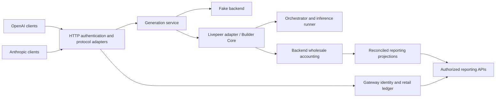

# Inference Gateway

[](https://github.com/NE-Build-Track/inference-gateway/actions/workflows/ci.yml)
[](pyproject.toml)
[](LICENSE)

OpenAI- and Anthropic-compatible APIs with pluggable backends, multi-user access,
and separate retail and wholesale accounting.

## Motivation

Agent applications should be able to change inference infrastructure without replacing
all their client integrations. Operators also need to know who used the service, what
they charged that user, and what the backend charged them. Those are different records.

Inference Gateway provides both API formats over a shared generation contract. It ships
with a deterministic fake for development and a Livepeer Builder Core adapter for paid
inference. Using the Anthropic interface does not imply that the underlying model is Claude;
both interfaces use the configured backend and model route.

## Capabilities and limits

- Text, SSE streaming, tool calls and tool-result follow-ups through both APIs.
- Multiple users and scoped API keys, administered through a local CLI.
- Versioned retail rates, cached-input accounting, append-only charges and adjustments.
- Backend wholesale evidence, correlated jobs and durable accounting reconciliation.
- Provider-shaped usage/cost reports with user isolation and administrative reporting.

This is a documented compatibility subset. The gateway and deterministic fake also support
reasoning, additional sampling controls, structured output, citations, simulated hosted search,
interleaved tool calls and image/audio fixtures. See the [extended feature contract](docs/product-specs/extended-generation.md)
for native fields and gateway extensions. Livepeer routes can explicitly enable structured output,
reasoning on/off, stop controls and parallel tools. Additional guarded adapter paths cover sampling,
reasoning effort/budgets and media input; they remain unverified and disabled locally. Citations,
hosted search and media output have fake contracts only.
A [stateless Responses subset and model catalog](docs/product-specs/models-and-responses.md) are
also implemented. Livepeer model routing now requires runner metadata `model_name`.
The gateway does not execute tools,
collect customer payments or replay generated responses. See the
[compatibility contract](docs/product-specs/compatibility.md).

## Native backend direction

Native routes support **vLLM, Ollama and SGLang** through original-body forwarding,
metadata-aware admission and read-only usage accounting. Enable them explicitly per model;
existing routes default to validated generation. Native strictness belongs to the backend.

The [native contract](docs/product-specs/native-inference.md) describes configuration and
limits. The [live-runner bundle](live-runner/README.md) supplies candidate manifests,
pinned images and readiness checks. The [Qwen3.8 acceptance report](live-runner/tests/qwen38-followup-2026-10-27.md)
records GPU tests on all three engines and four paid calls with reconciled wholesale costs.
Chain finality and production admission remain pending. Dependencies pin NE-Build-Track review revisions.

## Quick start

Install Python 3.12+ and [uv](https://docs.astral.sh/uv/), then:

```sh
git clone https://github.com/NE-Build-Track/inference-gateway.git
cd inference-gateway
uv sync --locked
uv run python -m inference_gateway
```

This starts the fake backend on `127.0.0.1:8000`. Local startup has no authentication
unless configured. No GPU, payer account or provider credentials are needed for this mode.
The Python package is `inference_gateway`; the installed CLI is `gateway`.

```sh
curl http://127.0.0.1:8000/v1/chat/completions \
  -H 'Content-Type: application/json' \
  -d '{"model":"fake-model","messages":[{"role":"user","content":"hello"}]}'
```

The fake returns `Echo: hello`. Its usage counts are synthetic and suitable only for tests.

## SDK clients

```python
from openai import OpenAI
from anthropic import Anthropic

openai = OpenAI(base_url="http://127.0.0.1:8000/v1", api_key="local", max_retries=0)
reply = openai.chat.completions.create(
    model="fake-model", messages=[{"role": "user", "content": "hello"}]
)
print(reply.choices[0].message.content)

anthropic = Anthropic(base_url="http://127.0.0.1:8000", api_key="local", max_retries=0)
with anthropic.messages.stream(
    model="fake-model", max_tokens=128,
    messages=[{"role": "user", "content": "hello"}],
) as stream:
    for text in stream.text_stream:
        print(text, end="", flush=True)
```

Use a CLI-issued secret instead of `local` in registry mode. Configure the public model
name for live inference. SDK retries are disabled here because another HTTP request can
start another paid generation. For OpenAI streaming usage, pass
`stream_options={"include_usage": True}`.

## Architecture



One gateway process owns a durable SQLite identity/retail database. Builder Core owns
its separate job/payment database. Retail charges use configured price versions;
wholesale costs retain backend evidence and uncertainty. Reconciliation never retries
inference. See [architecture](ARCHITECTURE.md) and [accounting](docs/design-docs/accounting.md).

## Configuration

| Setting | Purpose |
| --- | --- |
| `GATEWAY_BACKEND` | `fake` locally; `livepeer` in deployment |
| `GATEWAY_ACCOUNTING_DB` | Enables registry authentication and durable retail accounting |
| `GATEWAY_API_KEY` | Optional legacy shared key; cannot be combined with registry mode |
| `GATEWAY_MODEL_ROUTES` | Public model names mapped to backend applications/models |
| `GATEWAY_TIMEOUT_SECONDS` | Generation deadline; defaults to 300 seconds |
| `GATEWAY_APPROVED_ORCHESTRATORS` | Allowed discovery origins for Livepeer |
| `LPB_DISCOVERY_URL` | Required runner inventory endpoint; separate from the signer |
| `LPB_*` | Builder Core configuration and upstream payment credentials |

Registry mode fails closed until keys and prices are provisioned. For example:

```sh
export GATEWAY_ACCOUNTING_DB="$PWD/gateway.db"
uv run gateway users create alice
# Use the returned USER_ID. The following command prints the new secret once.
uv run gateway keys create USER_ID --name development --scopes inference,reports
uv run gateway prices set --model fake-model --version development-v1 \
  --input-per-million 0 --output-per-million 0
uv run python -m inference_gateway
```

The CLI also supports revocation, rotation, expiry, user disabling, adjustments and
reconciliation redrive. See [operations](docs/OPERATIONS.md) and the
[configuration/accounting reference](docs/design-docs/accounting.md).

## Build and deployment

```sh
make check
uv build
scripts/build-images.sh gateway
```

Two independent Compose deployments live under [deploy/livepeer](deploy/livepeer/README.md):

- **Gateway:** API service, embedded Builder Core, discovery, Clearinghouse and payment signer.
- **Orchestrator:** `livepeer/node` and local vLLM, with explicit off-chain/on-chain configuration.

Each deployment has its own configuration, secrets and persistent volumes. No sibling
application checkout is required. Livepeer dependencies build from pinned upstream commits;
model weights, GPU drivers, operator credentials, RPC access and funding remain external
prerequisites. A GPU is required for the supplied vLLM configuration. Neither funding nor
image publication happens implicitly.

## Development conventions

Keep the core framework-independent. Inject dependencies explicitly, translate wire formats
at adapters, preserve cancellation, and keep accounting retries separate from generation.
Never log prompts, tool arguments, credentials or raw upstream error bodies. Add behavior
and compatibility tests when contracts change; update the relevant documentation with them.

`make check` runs lint, formatting, strict typing, offline tests and documentation checks.
It includes a separate-process HTTP black-box suite. Paid acceptance is opt-in through
`make test-live` and `make test-accounting-live`; see the deployment guide for credentials.
Verification results and limits are recorded in [quality status](docs/QUALITY.md).

## Contributing

Contributions are welcome. Start with [CONTRIBUTING.md](CONTRIBUTING.md), follow the
[Code of Conduct](CODE_OF_CONDUCT.md), and use the issue/PR templates. Security issues
should follow [SECURITY.md](SECURITY.md). The project is licensed under [MIT](LICENSE).

Related repository upgrades must preserve native transport. The
[28 October compatibility review](docs/references/repository-compatibility-2026-10-28.md)
identifies a required Core PR #55 update after M3 moved payment transport into Core.
Use the locked dependencies; latest M3 is not yet a native-compatible replacement.
